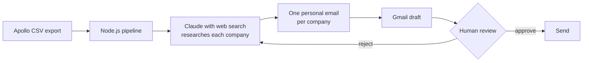

 

---

## About

Mechatronics Engineering student at SRH Hochschule Berlin, graduating March 2027. I build AI automation for B2B sales and finance teams and run it under Degheady Consulting. Everything below ships and runs.

## What I build

| Project | What it does | Stack |
|---|---|---|
| [**AI Sales Assistant**](https://danydegheady08-lang.github.io/degheady-consulting-demos/sales_assistant_demo.html) | Turns post-call notes into a follow-up email and a CRM summary | Claude API, JavaScript, Cloudflare Workers |
| [**Financial Reporting AI**](https://danydegheady08-lang.github.io/degheady-consulting-demos/finance_reporting_demo.html) | Turns raw financial data into a board-ready executive summary | Claude API, JavaScript, Cloudflare Workers |
| **HubSpot to Claude pipeline** | Watches a HubSpot deal, sends the call notes to Claude, parses the JSON and writes a follow-up email and a deal risk flag back to the deal | Make.com, Claude API, HubSpot |
| [**Outreach Automation**](https://github.com/danydegheady08-lang/ai-sales-assistant) | Reads a prospect CSV, researches each prospect, drafts a personalized email and queues it as a Gmail draft for human approval | Node.js, Gmail API, Claude API |
| [**API Proxy**](https://github.com/danydegheady08-lang/anthropic-proxy) | Cloudflare Worker that routes browser requests to the Anthropic API so no key sits in client-side code | Cloudflare Workers, Wrangler |

## How the outreach pipeline works

Nothing is sent automatically. Every email lands as a Gmail draft and a person approves it first.

## How I build

- **A human approves anything that leaves the building.** AI drafts, I decide.
- **No secrets in the browser.** API calls go through a Cloudflare Worker.
- **AI output is checked against the source** before it reaches a prospect.
- **One workflow, one measurable result.** I scope small, ship it, then measure it.

## Work with me

I am running three free pilots with small B2B sales and finance teams: one workflow, one week, one measurable result. In return I ask for short feedback and a testimonial if it saves you time. Message me on [LinkedIn](https://www.linkedin.com/in/dany-degheady-farhat-a00495224) to take a spot.

## Stack

 

